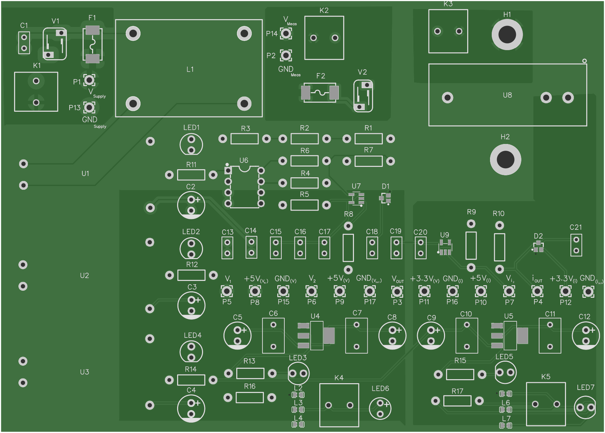
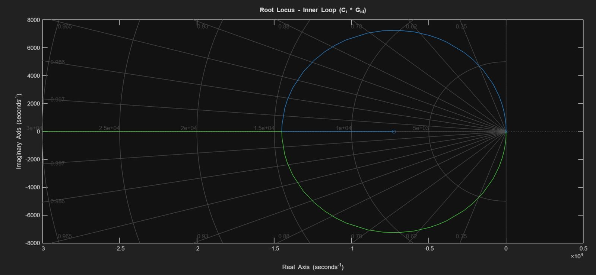
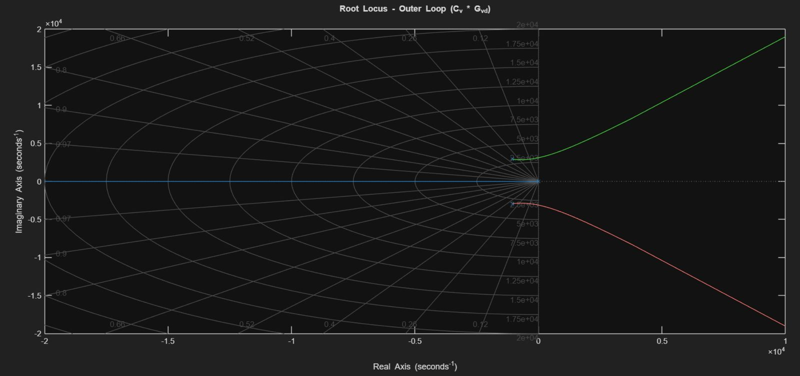
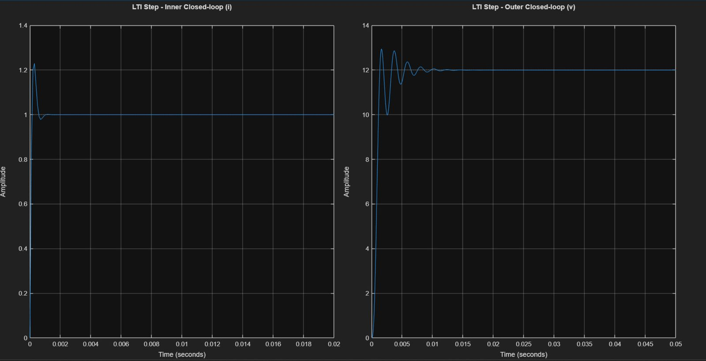
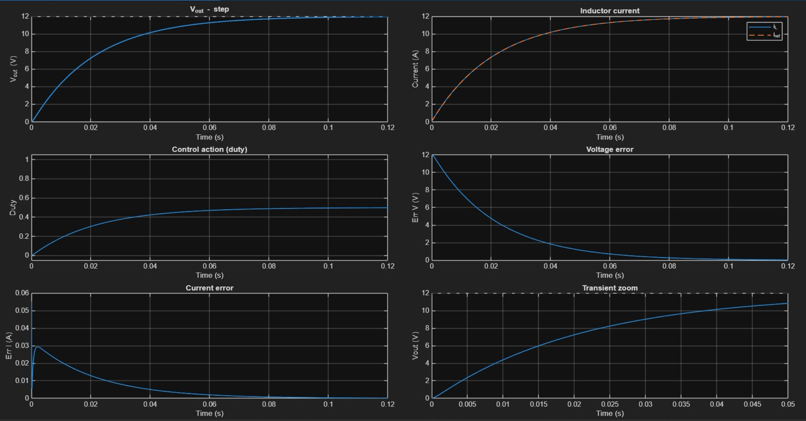
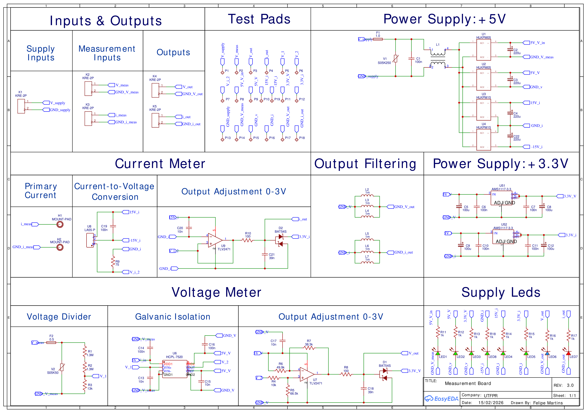
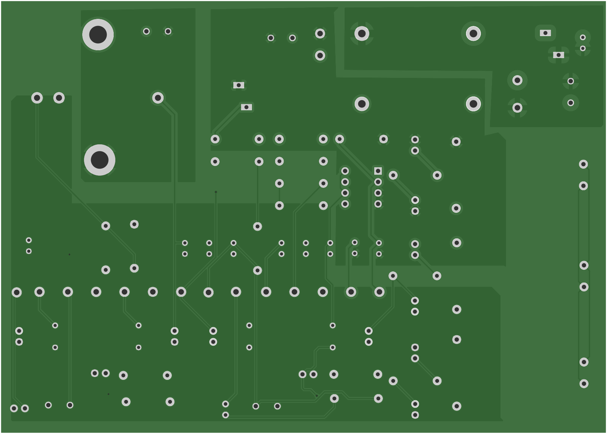

# Buck Converter Design and Cascaded PI Control

Design and control of a 24 V buck converter that heats the steel tape of a fiber-optic cable, plus a voltage and current measurement board. Undergraduate research at UTFPR (2025 to 2026), supervised by Prof. Renata Oliveira de Sousa.



## Overview

The research context is leak detection in dams with distributed fiber-optic temperature sensing: the cable is heated in a controlled way, and wet regions remove heat faster than dry ones. The corrugated steel tape inside an armored optical cable is used as the heating element, so the work starts by modeling it as a resistive load. A buck converter fed by a 24 V battery bank then delivers the heating power, regulated by a cascaded current and voltage PI controller.

## Load and converter design

- Load: corrugated steel tape of the cable, modeled from its geometry and resistivity, about 1 Ω over 12 m at operating temperature
- Input: 24 V battery bank
- Three operating points: 1, 5 and 10 W/m, that is 12, 60 and 120 W
- Ripple limits: 5% on the inductor current, 1% on the output voltage
- Switching frequency: 20 kHz (12 and 60 W) and 50 kHz (120 W)

| Operating point | 1 W/m | 5 W/m | 10 W/m |
|---|---|---|---|
| Output power (W) | 12 | 60 | 120 |
| Output voltage (V) | 3.46 | 7.75 | 10.96 |
| Duty cycle | 0.144 | 0.323 | 0.456 |
| Switching frequency (kHz) | 20 | 20 | 50 |
| Inductor (µH) | 820 | 682 | 220 |
| Output capacitor (µF) | 220 | 220 | 71 |

## Control design

Cascaded control on the averaged model of the converter:

- **Inner current loop:** the duty-to-inductor-current plant is close to an integrator, Vin/(L s). A PI sets the crossover near one tenth of the switching frequency: 2 kHz at 20 kHz and 5 kHz at 50 kHz.
- **Outer voltage loop:** with the current loop closed, the plant seen by the voltage loop is close to a first-order system, 1/(C s + 1/R). A PI sets the crossover five times below the current loop (400 Hz for a 2 kHz current loop), and its zero cancels the RC pole.
- **Saturation:** the duty cycle is limited to its valid range and the integrators stop accumulating while it is saturated (anti-windup).

Worked example from the analytic design, with L = 220 µH, C = 470 µF, R = 1 Ω and a 2 kHz current-loop crossover (example values from the report, not one of the three operating points above):

| Loop | Kp | Ki |
|---|---|---|
| Current | 0.115 | 1445 |
| Voltage | 1.18 | 2510 |

Check of these gains on the linear averaged model (`analysis/verify_cascade.py`, without PWM, saturation or current limit):

| Result | Value |
|---|---|
| Current loop phase margin | 51.8° at 2.5 kHz |
| Voltage loop phase margin | 90° at 400 Hz |
| 0 to 12 V reference step | 0.04% overshoot, 1.5 ms settling time (2%) |

The MATLAB script `analysis/buck_cascade_design.m` repeats the analysis with gains tuned by `pidtune` (Bode, Nyquist, root locus, step and ramp responses, simulation with duty saturation). The plots below come from that script. Its `pidtune` gains are different from the analytic ones above, so its simulated step settles in about 0.1 s instead of 1.5 ms.

| Root locus, current loop | Root locus, voltage loop |
|---|---|
|  |  |





More plots: [Bode of the plants](images/bode-plants.jpg) and [response to a reference ramp](images/time-response-ramp.jpg).

## Measurement board

Board that measures the DC voltage and current at the converter load and sends both signals, isolated and scaled to 0 to 3 V, to the microcontroller. Designed in EasyEDA (revision 3.0).

- **Voltage channel:** 0 to 40 V. Resistive divider, galvanic isolation with an HCPL-7520 isolation amplifier, and an op-amp stage (TLV2471) that scales the output to 0 to 3 V.
- **Current channel:** 0 to 40 A. LA55-P Hall-effect closed-loop transducer with a 75 Ω burden resistor, and an op-amp stage that scales the output to 0 to 3 V.
- **Supplies:** HLK-PM05 and HLK-PM15 AC-DC modules fed from the mains input, protected by fuses and varistors and filtered by an input inductor, with separate supplies for the voltage and current channels and AMS1117 3.3 V regulators.
- **Output protection:** BAT54S diodes clamp both outputs to the 0 to 3.3 V range.
- **Board:** 140 x 100 mm, two layers, with 19 test pads on the signals and supplies and eight indicator LEDs.

The signal conditioning chain follows the GBOX voltage and current measurement boards of the GESEP group (Allan Fagner Cupertino, Dayane do Carmo Mendonça and William Caires Silva Amorim, 2021), adapted to the ranges and sensors of this project.



| Top | Bottom |
|---|---|
|  |  |

## Repository structure

```
analysis/buck_cascade_design.m   cascaded PI design and simulation (MATLAB)
analysis/buck_plants.m           duty-to-current and duty-to-voltage plants (MATLAB, with L = 330 µH)
analysis/verify_cascade.py       check of the analytic gains (Python)
hardware/measurement-board/      schematic, PCB layout, Gerber files and BOM
images/                          plots and board images
```

Comments in the MATLAB scripts are in Portuguese.

## How to reproduce

- **MATLAB:** run `analysis/buck_cascade_design.m` (Control System Toolbox). Parameters are at the top of the script.
- **Python:** `pip install control numpy`, then `python analysis/verify_cascade.py`.
- **Board:** `hardware/measurement-board/gerber.zip` can be sent directly to a PCB manufacturer. `bom.csv` lists every component with its designator.

## Credits

Research supervised by Prof. Renata Oliveira de Sousa (UTFPR). The research report was written by Felipe Martins and Gabriela Bosco Azevedo.

## Attribution and usage

This repository is shared for portfolio and educational purposes. It comes from undergraduate research supervised by Prof. Renata Oliveira de Sousa, and the research report was written by Felipe Martins and Gabriela Bosco Azevedo. No license is granted for reuse or redistribution of the scripts, board files, images or text. If you want to use any of it, please contact me on [LinkedIn](https://www.linkedin.com/in/felipe-m-k-m-martins).

## Author

Felipe Martins, Mechatronics Engineering student at UTFPR, double degree at ENSTA.
[LinkedIn](https://www.linkedin.com/in/felipe-m-k-m-martins)
